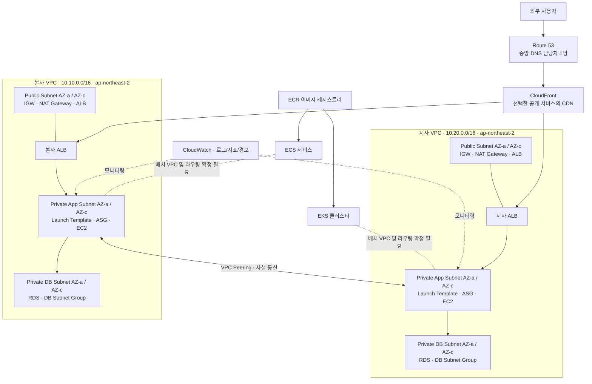
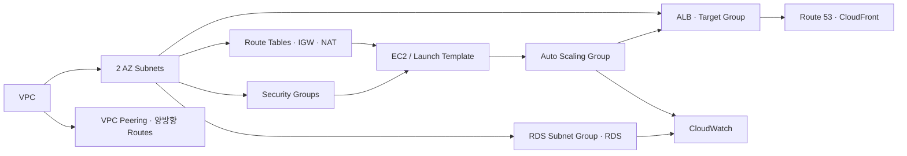

# KAIST 하이브리드 클라우드 MSA 인프라 — 전체 구성도 및 구축 청사진

> **문서 상태:** 설계 초안 v1.0 · 2026-10-19  
> **목적:** 개인별 전체 실습 → 팀 역할 분담 → 통합 구축 → 보안 진단 → 발표  
> **확정:** 본사 ↔ 지사 AWS VPC 연결은 **VPC Peering**. Route 53은 **전담자 1명**이 본사·지사 DNS를 통합 관리.  
> **미확정:** 실제 도메인, ECS/EKS 배치 위치, 온프레미스–AWS VPN 연결 여부, 데이터 동기화 및 장애 전환 정책.

## 1. 프로젝트 주제 및 범위

### 프로젝트 01 — 하이브리드 클라우드 MSA 인프라 구축
- 팀주제 1: KAIST Docker & Kubernetes 기반 프라이빗 클라우드 환경 구축
- 팀주제 2: KAIST Terraform 기반 AWS 하이브리드 클라우드 환경 구축
- 본사팀 / 지사팀: Terraform으로 VPC, 2개 AZ, Public/Private Subnet, NAT Gateway, ALB, ASG, RDS 구축
- 콘솔 담당: Route 53, VPC Peering, CloudFront, CloudWatch (운영 절차에 따라 일부 IaC 전환 가능)
- ECR/ECS 구축팀 및 EKS 구축팀

### 프로젝트 02 — 클라우드 인프라 기반 정보시스템 보안 진단
- 팀주제 1: NGFW 보안 솔루션 적용 및 프라이빗 클라우드 보안 진단
- 팀주제 2: AWS 보안 솔루션 적용 및 AWS 퍼블릭 클라우드 보안 진단

## 2. AWS 전체 논리 구성도



**도식 주의:** CloudFront는 반드시 모든 ALB 앞에 놓아야 하는 것은 아니다. Route 53 레코드는 서비스별로 CloudFront 배포 또는 ALB를 대상으로 설정한다. ECR은 이미지 저장소이지 네트워크 트래픽 경유 지점이 아니다. 위 ECS/EKS 점선은 팀 간 연계 관계를 나타내며 확정된 실제 배포 위치가 아니다.

## 3. 본사·지사 IP 주소 설계안

| 구분 | 본사 HQ | 지사 Branch |
|---|---|---|
| VPC | `10.10.0.0/16` | `10.20.0.0/16` |
| Public AZ-a | `10.10.1.0/24` | `10.20.1.0/24` |
| Public AZ-c | `10.10.2.0/24` | `10.20.2.0/24` |
| Private App AZ-a | `10.10.101.0/24` | `10.20.101.0/24` |
| Private App AZ-c | `10.10.102.0/24` | `10.20.102.0/24` |
| Private DB AZ-a | `10.10.201.0/24` | `10.20.201.0/24` |
| Private DB AZ-c | `10.10.202.0/24` | `10.20.202.0/24` |

- 위 대역은 **제안값**이며 개인 실습 및 최종 통합 전에 확정한다.
- Public Route Table: `0.0.0.0/0 → IGW`.
- Private App Route Table: `0.0.0.0/0 → 동일 AZ NAT Gateway` (고가용성 구성 시 AZ별 NAT).
- Private DB Route Table: 기본적으로 인터넷 기본 경로 없이 운영. 필요한 내부 경로만 명시.
- Peering 경로: 본사 관련 Route Table `10.20.0.0/16 → pcx-...`; 지사 관련 Route Table `10.10.0.0/16 → pcx-...`.
- VPC Peering은 **비전이적(non-transitive)**. Peering 자체가 인터넷·NAT·VPN 경유를 제공하지 않는다.

## 4. 서비스 계층과 주요 의존성



**보안 그룹 원칙:** 인터넷 → ALB는 80/443(필요한 경우), ALB → 애플리케이션은 서비스 포트만, 애플리케이션 → RDS는 DB 포트만 허용. DB는 Public Access 비활성화. SSH는 공개 개방하지 않고 가능하면 SSM Session Manager를 사용한다.

## 5. Route 53 중앙 DNS 담당 범위

| 레코드 예시 | 대상 | 비고 |
|---|---|---|
| `hq.<보유도메인>` | 본사 ALB 또는 CloudFront | 공개 서비스 정책에 따라 선택 |
| `branch.<보유도메인>` | 지사 ALB 또는 CloudFront | 공개 서비스 정책에 따라 선택 |
| ACM 검증 CNAME | ACM이 제시한 값 | 인증서 DNS 검증 |

- **Route 53 담당자 1명**이 Hosted Zone, 레코드, ACM 검증, DNS 테스트를 통합 관리한다.
- 본사·지사팀은 ALB DNS 이름, ALB Hosted Zone ID, 서비스 포트/헬스체크 경로를 전달한다.
- `example.com` 계열은 문서 예시용으로만 사용한다. 실제 서비스에는 소유/위임된 도메인이 필요하다.
- DNS Failover는 선택 심화 과제이며, 앱과 DB의 실제 장애 대응/데이터 동기화가 선행되어야 한다.

## 6. 팀별 역할 및 인수인계

| 팀 | 구축 책임 | 다른 팀에 전달할 항목 |
|---|---|---|
| 본사팀 | 본사 VPC, Subnet, IGW, NAT, SG, ALB, ASG, RDS | VPC ID/CIDR, Subnet ID, ALB DNS/Zone ID, 서비스 엔드포인트 |
| 지사팀 | 지사 VPC, Subnet, IGW, NAT, SG, ALB, ASG, RDS | VPC ID/CIDR, Subnet ID, ALB DNS/Zone ID, 서비스 엔드포인트 |
| 네트워크/Peering 담당 | Peering 요청·수락, 양방향 Route, 통신 검증 | Peering ID, 라우팅 및 통신 테스트 결과 |
| Route 53 담당 | 본사·지사 DNS, 인증서 DNS 검증 | 도메인/레코드 목록, DNS 확인 결과 |
| ECR/ECS팀 | 이미지 저장/배포, ECS 서비스 | 이미지 URI, 서비스 주소, 보안 그룹/서브넷 요구사항 |
| EKS팀 | EKS, 워크로드, Service/Ingress | 클러스터/서비스 주소, 통신·권한 요구사항 |
| 보안 진단팀 | IAM, 로깅, 네트워크/클라우드 보안 점검 | 진단표, 증적, 위험도 및 개선 조치 |

※ 위 표는 역할 **제안**이며, 실제 팀원 배정은 개인별 실습 이후 결정.

## 7. 개인 실습 → 최종 통합 구축 순서

### Round 0 — 준비
1. 개인별 AWS 인증 및 MFA 확인; 루트 계정·키 공유 금지.
2. AWS CLI, Terraform, Git 설치/버전 확인.
3. 개인 실습 리소스 태그 및 예산 알림 설정.
4. Terraform 작업 디렉터리 생성, `terraform init / fmt / validate / plan` 확인.

### Round 1 — 기본 네트워크
1. 본사 VPC와 2 AZ Public/Private Subnet 생성.
2. IGW, Route Table, SG, 테스트 EC2 생성.
3. NAT Gateway는 필요한 단계에서만 생성하고 비용 확인.
4. 지사 VPC를 별도 CIDR로 구축.
5. VPC Peering 연결, 라우팅, SG 허용 후 **사설 IP 통신 검증**.

### Round 2 — 고가용성 웹/DB
1. Launch Template, Target Group, ALB, ASG 생성.
2. ALB 분산 확인, ASG 인스턴스 장애 복구 확인.
3. DB Subnet Group 및 RDS 생성; 앱에서 DB 접속 확인.
4. 요구되는 경우 Multi-AZ RDS 및 AZ별 NAT로 고가용성 강화.

### Round 3 — 컨테이너/서비스 연계
1. ECR 이미지 Push/Pull.
2. ECS 최소 서비스 배포.
3. EKS 최소 워크로드 배포 및 접근 검증.
4. 컨테이너 서비스와 VPC·DB의 연결 경로를 확정.

### Round 4 — 운영/보안/발표
1. Route 53, ACM, CloudFront 연결.
2. CloudWatch 메트릭·로그·알람, 필요 시 CloudTrail 등 구성.
3. 보안 그룹·IAM·암호화·로그 및 승인된 범위의 보안 진단.
4. 장애 복구, 네트워크 통신, DNS, 서비스 응답 증적 수집.
5. 아키텍처, 담당 역할, 구축 과정, 문제 해결, 검증, 개선점을 PPT에 반영.

## 8. Terraform 디렉터리 제안

```text
kaist-hybrid-cloud/
├── modules/
│   ├── vpc/
│   ├── alb/
│   ├── asg/
│   └── rds/
├── environments/
│   ├── hq/
│   ├── branch/
│   └── peering/
├── docs/
│   ├── architecture.md
│   ├── ip-plan.md
│   ├── test-results.md
│   └── troubleshooting.md
└── README.md
```

- 개인 연습에서는 로컬 상태로 시작해도 되지만, **공동 계정 통합 구축 전에는 S3 Remote Backend와 잠금(`use_lockfile`)을 적용**한다.
- 팀별 상태 파일 경로를 분리하고 같은 리소스를 둘 이상의 Terraform State가 관리하지 않게 한다.
- 자격 증명, 비밀번호, `.tfstate`, `.terraform/` 등 민감하거나 생성되는 파일은 Git에 올리지 않는다.

## 9. 프로젝트 02 보안 진단 연결

| 구분 | 진단 예시 | 증적 |
|---|---|---|
| 프라이빗 클라우드 | NGFW 정책, 접근통제, Kubernetes RBAC, 이미지/노드 보안 | 정책표, 접근 차단 테스트, 로그 |
| AWS 네트워크 | SG 최소 허용, DB 비공개, 라우팅/Peering 범위 | SG·Route Table 캡처, 통신 테스트 |
| AWS 계정 | IAM 최소 권한, MFA, 키 관리 | IAM 설정·점검표 |
| AWS 데이터 | RDS/S3 암호화, 백업 및 복구 | 설정·복구 테스트 |
| 모니터링 | CloudWatch/CloudTrail 및 보안 이벤트 확인 | 대시보드, 경보, 이벤트 로그 |

**보안 진단은 소유하거나 명시적으로 승인받은 리소스에서만 수행한다.**

## 10. 하이브리드 클라우드 용어의 정확한 범위

현재 확정된 **VPC Peering은 AWS 내부의 두 VPC 연결**이다. 이 연결만으로 기존 VMware/Docker/Kubernetes 프라이빗 클라우드와 AWS가 네트워크로 연결되지는 않는다.

실제 온프레미스 ↔ AWS 사설 통신이 프로젝트 요구사항이라면 Site-to-Site VPN 또는 Direct Connect 등 **별도 연결 설계**가 필요하다. 프라이빗 클라우드와 AWS를 단순히 함께 시연하는 것인지, 실제 네트워크로 연동하는 것인지 최종 발표 전에 명확히 정한다.

## 11. 비용 및 실습 종료 체크

- NAT Gateway, ALB, RDS, EKS, EC2, 퍼블릭 IPv4, 데이터 전송 등은 요금이 발생할 수 있다.
- 예산 알림은 일반적으로 리소스를 자동 중단하지 않는다.
- 고비용 리소스는 실습 검증 직전에 만들고, 증적 확보 후 삭제한다.
- `terraform destroy` 후에도 ECR 이미지, CloudWatch 로그, S3 Backend, Route 53 Hosted Zone, 수동 생성 리소스 등 잔여 비용 요소를 확인한다.
- 팀 공용 계정에서 `destroy`는 승인 없이 실행하지 않는다.

## 12. PPT 권장 목차

1. 프로젝트 배경 및 요구사항
2. 전체 하이브리드 클라우드 아키텍처
3. 본사·지사 VPC / IP 설계
4. Terraform IaC 및 고가용성
5. VPC Peering 사설 통신
6. ECS/EKS 기반 MSA 구성
7. Route 53 / CloudFront / CloudWatch 운영
8. 보안 진단 및 개선
9. 장애 테스트·트러블슈팅
10. 팀 역할 및 프로젝트 성과

---

### 현재 진행 상태 (2026-10-19)
- AWS CLI v2.37.13 정상 동작 확인
- Terraform v1.16.5 설치 확인 (Windows 32비트 빌드: `windows_386`; 64비트 교체 권장)
- AWS CLI 기본 리전: `ap-northeast-2`
- IAM 사용자 인증 성공 (`aws sts get-caller-identity`)
- 개인 실습 폴더 생성: `D:\kaist-hybrid-cloud\hq`
- **아직 확인되지 않음:** `versions.tf`, `provider.tf` 저장 및 `terraform init` 성공
- **다음 실습:** Terraform 초기화 → 본사 VPC 생성
